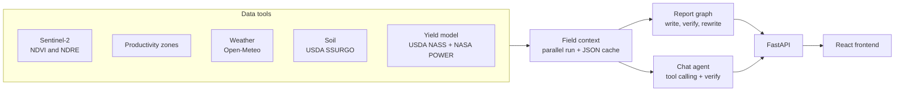

# RyyderBros Field Pilot

AI crop scouting for Alabama corn and cotton fields. It combines satellite imagery, weather, soil surveys, and county yield history, and an AI agent explains the results. Every number in an AI answer is checked against the source data.

**Live demo:** https://ryyderbros-fieldpilot.onrender.com/

## Architecture

**Stack:** Python, FastAPI, LangGraph, Groq, scikit-learn, React, Docker, Render
